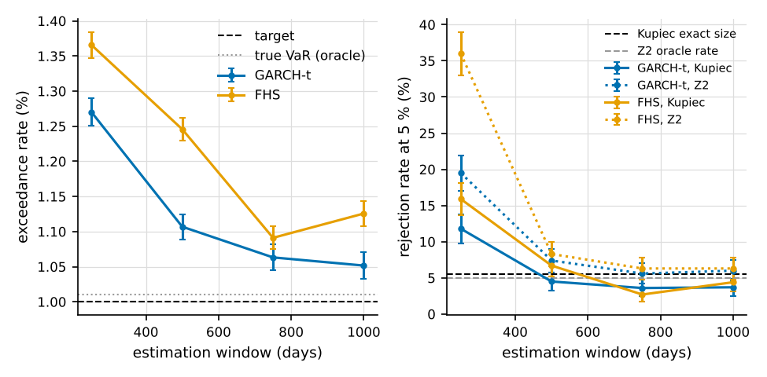
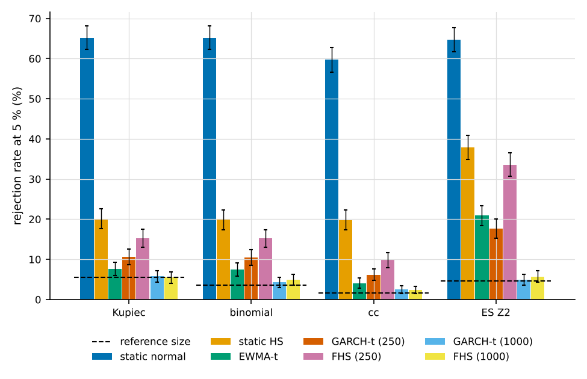
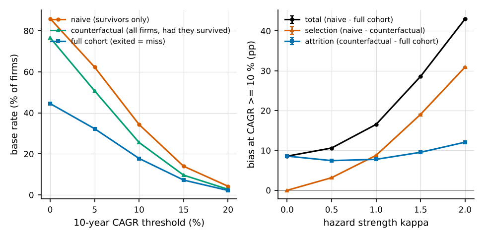
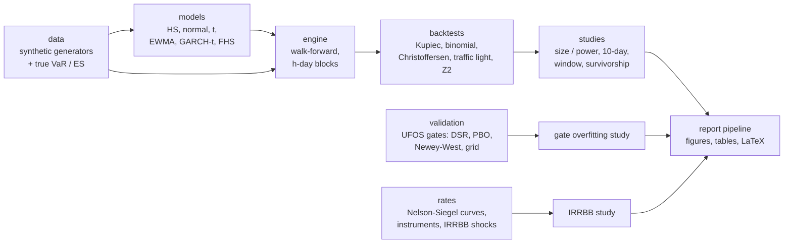

# Risk Lab

A bank-style market-risk lab: VaR / ES models, regulatory backtests and a
model-validation report — with the tests' own size and power measured on
synthetic data with known truth. Since v0.7 also interest rate risk in the
banking book (IRRBB).

Part of UFOS.ai. **Status: v0.7.** Python ≥ 3.10, numpy and scipy (matplotlib
for the figures). Synthetic data only; no imports from or into the HedgeFund backend.

## Key findings

All numbers come from the saved full runs in `studies/results/` (Monte-Carlo
rates in % ± their standard error).

- **Kupiec is mis-sized for a one-year backtest.** At T = 250 days its exact
  size is 9.48 % at a nominal 5 %; the exact binomial test keeps 4.12 %.
  ([summary](studies/results/var_backtest_power_full_summary.md))
- **A 250-day GARCH(1,1)-t window over-rejects although the model is
  correct.** Kupiec rejects 10.6 ± 1.0 % against an exact size of 5.5 %, and
  the ES test Z2 rejects 17.7 ± 1.2 % (T = 1000).
  ([summary](studies/results/var_backtest_power_full_summary.md))
  - From 500 days on, Kupiec is back near its size (4.5 ± 0.7 %).
    ([summary](studies/results/estimation_window_full_summary.md))
  - But the VaR stays slightly anti-conservative: at 1000 days the exceedance
    rate is +0.041 ± 0.007 percentage points above the true VaR's.
    ([summary](studies/results/estimation_window_full_summary.md))
- **Static models miss volatility clustering.** A static normal VaR on
  GARCH-t data is rejected by Christoffersen cc in 59.7 ± 1.6 % and by Z2 in
  64.7 ± 1.5 % of the backtests (T = 1000).
  ([summary](studies/results/var_backtest_power_full_summary.md))
- **√10 scaling overstates a fat-tailed 10-day VaR.** Scaling the GARCH-t
  one-day VaR overstates it by +8.6 ± 0.3 % on iid t5 data.
  ([summary](studies/results/horizon_10d_full_summary.md))
- **Survivorship bias is large.** In a synthetic universe (hazard strength 1),
  34.3 % of the survivors show a 10-year CAGR ≥ 10 %.
  - Had every firm survived, the rate would be 25.5 %: selection bias
    8.8 ± 0.02 points.
  - Counting exits as misses, it is 17.8 %.
  ([summary](studies/results/survivorship_full_summary.md))
- **The UFOS validation gates stop searched noise but have little power.**
  The statistical gates pass at most 0.5 % of best-of-K noise rules (standard
  preset). A rule with a true Sharpe of 1.0 passes in only 13.1 ± 0.8 % of the
  paths with 10 years of data and 35.8 ± 1.1 % with 20 years (K = 64).
  ([summary](studies/results/gate_overfitting_full_summary.md))
- **The IRRBB outlier test depends on the deposit model.** A synthetic retail
  bank loses 17.6 % of Tier 1 in EVE under the parallel-up shock (BCBS 2016
  EUR sizes), above the 15 % outlier threshold.
  - Moving only the non-maturity-deposit assumptions inside their caps
    (core share 50–90 %, average maturity 1–5 years) moves the worst EVE
    decline between 1.5 % and 31.1 % of Tier 1.
  - The results are deterministic. Every regulatory parameter is cited to its
    article; only the NMD caps are marked as an assumption.
  ([summary](studies/results/irrbb_scenarios_full_summary.md))

<p>



</p>

## Reproduce in 3 commands

From `UFOS.ai/RiskLab/`, Linux / macOS (bash):

```
python3 -m venv .venv && . .venv/bin/activate
python -m pip install --require-hashes -r requirements.lock
python -m unittest discover -s tests && python studies/var_backtest_power.py --mode smoke
```

This was verified on Linux with Python 3.10 (a fresh venv on the reference VM).
The build container has no access to PyPI.

Windows PowerShell:

```
py -3.12 -m venv .venv; .venv\Scripts\Activate.ps1
python -m pip install --require-hashes -r requirements.lock
python -m unittest discover -s tests; python studies\var_backtest_power.py --mode smoke
```

The PowerShell commands are **unverified**: no Windows machine with
PowerShell was available. The lock's Windows wheels were checked (see
"Dependencies").

With `requirements.lock` (core only), the figure tests are skipped with a
message. Install `requirements-report.lock` instead to run them too.

**Quickstart** (`examples/quickstart.py`, 28 lines): a static normal VaR and
a GARCH(1,1)-t VaR on one synthetic GARCH-t6 path, four backtests each.

```
$ python examples/quickstart.py
GARCH(1,1)-t6 losses: 500-day window, 1000 forecast days, VaR 0.99, ES 0.975

static normal: 32 exceedances of 1000 (expected 10)
  kupiec_pof                       p = 0.000  -> reject
  christoffersen_cc                p = 0.000  -> reject
  acerbi_szekely_z2                p = 0.002  -> reject
  traffic_light (last 250 days)    -> yellow

GARCH(1,1)-t: 15 exceedances of 1000 (expected 10)
  kupiec_pof                       p = 0.139  -> not rejected
  christoffersen_cc                p = 0.265  -> not rejected
  acerbi_szekely_z2                p = 0.124  -> not rejected
  traffic_light (last 250 days)    -> green
```

This is one path, for illustration (seed 1). The rejection *rates* are in
the size / power study.

## Architecture



| module | role |
|---|---|
| `risklab.data` | synthetic generators (iid normal / t, GARCH(1,1), regime switching) and their true VaR / ES |
| `risklab.models`, `risklab.dists`, `risklab.analytic` | one-day VaR / ES models and predictive distributions |
| `risklab.engine`, `risklab.horizon`, `risklab.bootstrap` | walk-forward backtesting, 10-day VaR (√10, GARCH Monte Carlo, block bootstrap) |
| `risklab.backtest` | Kupiec, exact binomial, Christoffersen ind / cc, Basel traffic light, Acerbi-Szekely Z2 |
| `risklab.validation` | the UFOS strategy-platform gates, re-implemented, and the simulator of the gate study |
| `risklab.rates` | IRRBB: Nelson-Siegel(-Svensson) curves and fitting, banking-book instruments and a synthetic bank, duration / DV01 / key rates, the six standardised shocks with the floor, ΔEVE / ΔNII, outlier tests |
| `risklab.report` | deterministic export (code fingerprints), figures, LaTeX tables |
| `studies/`, `report/`, `examples/`, `tests/` | the six studies, the report sources and build, the quickstart, the unit tests |

The conventions (signs, confidence levels, seeds, model, engine and backtest
details, data policy) are in [`docs/conventions.md`](docs/conventions.md).
The detailed study designs and results are in [`docs/studies.md`](docs/studies.md).

## Studies

Runtimes are full runs, measured in the cloud build container (2 cores, two
studies running in parallel).

| study | question | design | headline result | full run | summary |
|---|---|---|---|---|---|
| `var_backtest_power` | Do the VaR / ES backtests keep their size, and how much power do they have? | 8 models × 5 generators, T = 250 / 1000, M = 1000 | Kupiec size 9.48 % at T = 250; static normal on GARCH-t: cc 59.7 ± 1.6 % | 42 min | [md](studies/results/var_backtest_power_full_summary.md) |
| `horizon_10d` | How good are √10, GARCH Monte Carlo and the bootstrap for the 10-day VaR? | 3 generators, 500-day window, M = 1000 | √10 × GARCH-t on iid t5: +8.6 ± 0.3 % bias | 2 min | [md](studies/results/horizon_10d_full_summary.md) |
| `estimation_window` | How long must the GARCH-t / FHS window be? | windows 250–1000, paired against the true VaR, M = 1000 | GARCH-t Kupiec near its size from 500 days (4.5 ± 0.7 %), Z2 still 7.4 ± 0.8 % against 5.0 at 500 days; +0.041 ± 0.007 pp excess at 1000 | 34 min | [md](studies/results/estimation_window_full_summary.md) |
| `survivorship` | How much do survivors-only base rates overstate growth? | 2000 synthetic firms, growth-dependent exits, M = 2000 | 34.3 % naive vs 25.5 % counterfactual vs 17.8 % full cohort | 7 s | [md](studies/results/survivorship_full_summary.md) |
| `gate_overfitting` | How often does a searched noise rule pass the UFOS gates, and with what power? | MA-crossover family, K = 1–256, 5 / 10 / 20 years, M = 2000 | false positives ≤ 0.5 %; power 13.1 ± 0.8 % (10 y) at Sharpe 1 | 30 min | [md](studies/results/gate_overfitting_full_summary.md) |
| `irrbb_scenarios` | Does a synthetic bank breach the IRRBB outlier tests, and how much do the deposit assumptions matter? | reference bank, six BCBS shocks (2016 / 2024 EUR sizes, EU floor on both), NMD grid, 2000 variants of the bank (±30 % composition) | worst ΔEVE 17.6 % of Tier 1 (outlier); NMD grid 1.5–31.1 %; robust to ±30 % changes in the composition (65.6 ± 1.1 % of the variants breach) | 32 s | [md](studies/results/irrbb_scenarios_full_summary.md) |

Every study also has a smoke mode (used by the tests and CI) and a default
demo mode. Run a full run with `--mode full --save-results`.

## Reports

Four LaTeX documents are generated from the saved results:

- the validation report (`--doc validation`, the default);
- the overfitting study of the UFOS gates (`--doc overfitting`);
- the IRRBB report (`--doc irrbb`, 8 pages);
- a 3–4 page project overview (`--doc overview`).

Report PDFs are **not** kept in the repository. The figure PDFs in
`report/figures/` are LaTeX assets and stay. Build the reports yourself (needs
`requirements-report.lock` and a TeX installation with the packages listed in
`report/build_report.py`):

```
python report/build_report.py --doc validation       # -> out/report/validation_report.pdf
python report/build_report.py --doc overfitting      # -> out/report/overfitting_study.pdf
python report/build_report.py --doc irrbb            # -> out/report/irrbb.pdf
python report/build_report.py --doc overview         # -> out/report/overview.pdf
python report/build_report.py --doc overview --publish --publish-to <dir outside the repo>
```

How the build works:

- It checks the toolchain first and refuses stale inputs: a results file whose
  code fingerprint does not match the current code.
- `--publish-to` must be an existing directory outside the repository.
- The prose slots of the three detailed reports are written by the author. They are
  marked as orange boxes, so a build with open slots is visibly a draft.

## Quality

- **Tests:** 256 unit tests (`python -m unittest discover -s tests`), no network.
  - They include golden tables, closed-form checks, smoke runs of every study
    and the quickstart, and byte-level reproducibility of the figures.
  - A parity test on the HedgeFund side compares `risklab.validation` with
    the platform's gate code on fixed inputs.
- **Reviews:** every version from v0.1 to v0.6 had an independent review. Its
  findings were fixed in a follow-up round before the next version.
- **Reproducibility, as tested:**
  - **Locked versions vs saved results:** the saved results in
    `studies/results/` were produced with numpy 2.5.3 and scipy 1.18.1, as
    recorded in their `meta`. The locks pin numpy 2.2.6 and scipy 1.15.3.
    A full run from the locks is therefore **not** expected to match the
    saved results byte for byte. The random streams and the numerical
    libraries may differ; the conclusions should not.
  - **Seeds:** the same integer seed gives the same results within the same
    numpy version. numpy does not promise identical streams across versions,
    so every export records the numpy version.
  - **Code fingerprints:** every saved full run records a fingerprint of the
    code that produced it, and the report build refuses a mismatching one.
    - The fingerprint is the sha256 of the study script and the risklab
      modules it imports.
    - Since v0.6 the `__version__` line is normalised out, so a version-only
      bump keeps results valid; any other change still invalidates them
      (tested).
    - The v0.5 results were re-keyed to this definition after checking that
      their producing code has the same normalised fingerprint as the v0.6
      code. Their rows are unchanged, and `meta.code_sha256_rekey` records the
      previous value.
  - **Re-runs:** re-running all saved studies under a new package version gave
    identical result rows (v0.4 → v0.5). Under v0.6, the re-run
    estimation-window study gave identical rows again.
  - **Figures:** byte-identical with the same matplotlib and FreeType
    versions. They differ across matplotlib versions; the plotted data do not.
  - **Report PDFs:** two builds in the same container are byte-identical (fixed
    `SOURCE_DATE_EPOCH`, no PDF date).

## Dependencies

- `requirements.in` / `requirements-report.in`: the direct dependencies,
  unpinned.
- `requirements.lock` / `requirements-report.lock`: every package pinned, with
  the sha256 hash of every release file on PyPI. Install with
  `pip install --require-hashes`.
- **Generator:** uv 0.13.7 on Linux, from `UFOS.ai/RiskLab/`:

  ```
  uv pip compile requirements.in --universal --fork-strategy fewest --generate-hashes --python-version 3.10 -o requirements.lock
  uv pip compile requirements-report.in --universal --fork-strategy fewest --generate-hashes --python-version 3.10 -o requirements-report.lock
  ```

  - `--universal --fork-strategy fewest` gives **one** set of versions for all
    platforms and all Python versions ≥ 3.10. The exact set: numpy 2.2.6,
    scipy 1.15.3, matplotlib 3.10.9 and its dependencies, as pinned in the
    lock.
  - uv takes the hashes from the package index. pip-tools 7.6.2
    (`pip-compile --generate-hashes`) was tried first: it downloads every
    release file to hash it (several GB for numpy and scipy) and did not
    finish within the session limits.
- **Platform check:** every pinned package has a wheel for CPython 3.10, 3.11,
  3.12 and 3.13 on both `win_amd64` and `manylinux` x86_64 (checked against
  PyPI's metadata).
  - Linux, Python 3.10: installed with `--require-hashes` and tested.
  - Linux, Python 3.12 and 3.13: hash-checked download of every wheel.
  - Windows: not run.
- **CI:** `ci/risklab-tests.yml`. Copy it to `.github/workflows/`, because
  `.github` is protected.
  - It installs `requirements-report.lock` with `--require-hashes` and runs
    the tests, the quickstart and every study in smoke mode.
  - Python 3.10, 3.12 and 3.13.
  - The actions are pinned by commit SHA.

## Limitations

- **Data:** synthetic only, with known truth. Real data stays outside the
  repository (`local_data/`, git-ignored).
- **Scope:** one-day and 10-day VaR / ES for a single risk factor. There are
  no portfolios, no multivariate models and no Z1 / Z3 ES tests yet.
- **Monte-Carlo uncertainty:** the ± se covers Monte-Carlo noise only. The
  conclusions depend on the chosen generators and parameters, which are
  stated in each summary.
- **IRRBB:** single currency, synthetic bank, no credit spreads (CSRBB), no
  prepayment or early-redemption options, constant balance sheet for NII.
  Only the NMD caps are unverified (marked ASSUMPTION); the other regulatory
  parameters are cited to their articles.
- **Gate study:** one rule family and one cost level. G3, the cost and
  stress parts of G6, and G8 are out of scope.
- **Reports:** the report prose (the text slots) is open; it is written by
  the author.

## Open points

- **CI:** copy `ci/risklab-tests.yml` to `.github/workflows/` (user).
- **Windows:** run the PowerShell commands once on Windows and mark them as
  verified.

## Roadmap

- **Done:**
  - v0.1–v0.3: models, backtests, 10-day VaR;
  - v0.4: the validation report pipeline, the estimation-window and
    survivorship studies;
  - v0.5: the UFOS gate re-implementation and its overfitting study;
  - v0.6: presentation, quickstart, locks, CI file and the overview document;
  - v0.7 (this version): interest rate risk in the banking book (IRRBB):
    curves, instruments, standardised shocks, ΔEVE / ΔNII, outlier tests, the
    IRRBB study and report.
- **Next:**
  - v0.8: credit risk;
  - v0.9: a reverse DCF.
