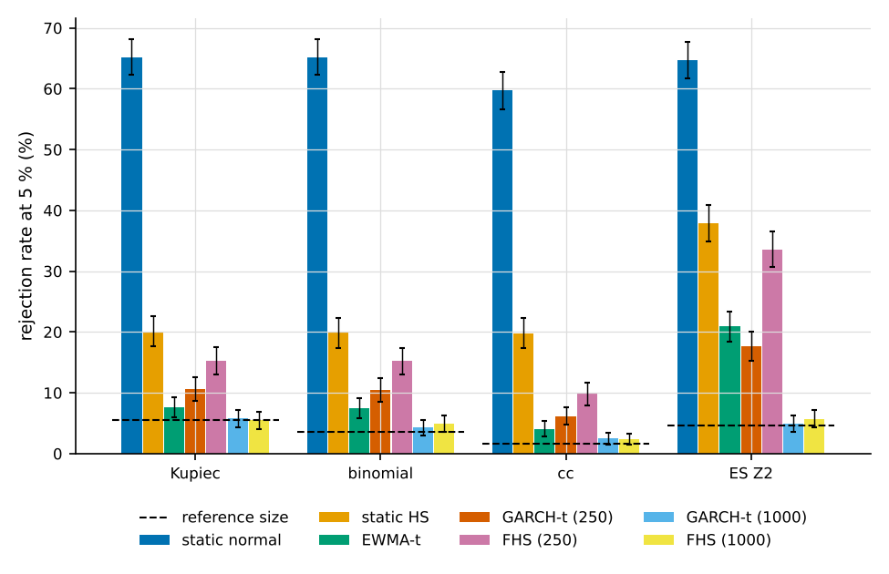
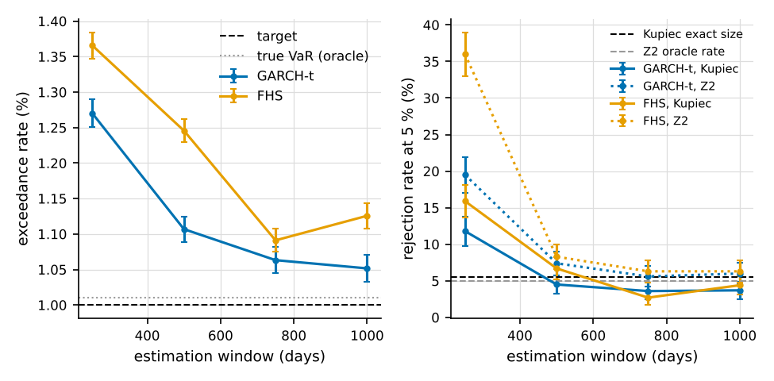
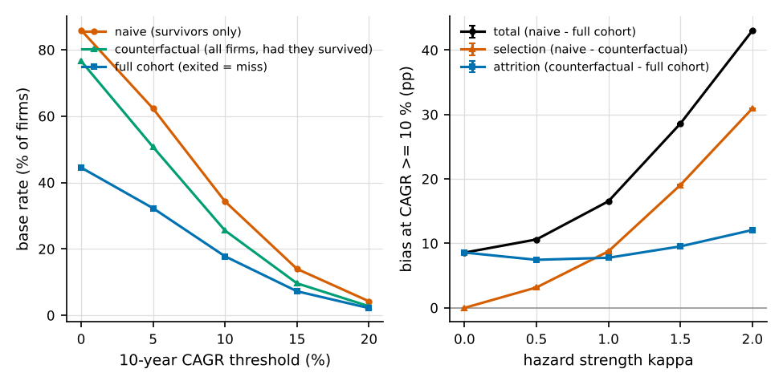

# Risk Lab studies and reports in detail

The design and the full-run results of every study, and how the two reports are built.
Moved here from the README in v0.6; the numbers come from `studies/results/` (full runs).
The README has the short overview.

## The size / power study

```
python studies/var_backtest_power.py                # M = 30: a demo; measured 126 s (2.1 min) on the user's PC
python studies/var_backtest_power.py --mode full --save-results    # M = 1000: about 43 minutes in the cloud container
python studies/var_backtest_power.py --m 300 --out-dir out/my_run
```

What it does:

- Each replication draws `window + T` synthetic days (T = 250 and T = 1000;
  window = 250 unless stated).
- The models are fitted walk-forward on a rolling window and forecast the
  next day's 99 % VaR and 97.5 % ES.
- Refits: static models daily; the Student-t model every 50 days; GARCH-t, FHS
  and EWMA-t every 50 days, with a daily variance update in between.
- Kupiec, the exact binomial test, ind, cc (all on the 99 % VaR, at 5 %) and
  the traffic light run on the T forecast days. The Acerbi-Szekely Z2 test
  (97.5 % ES, one-sided, 500 Monte-Carlo draws) runs on the same days.
- Its Monte-Carlo seed is a `SeedSequence` child of the data seed.
- **Reference size:**
  - Kupiec and the binomial test: the exact size per T, from binomial sums.
  - ind, cc and Z2: the empirical rate of the oracle row of the same data and T.
- **Size** rows:
  - the oracle (the true VaR) on all generators;
  - correctly specified estimated models: normal on normal, t on t, and
    GARCH-t and FHS on GARCH-t data. Their rate can differ from the
    reference: that is estimation risk.
  - GARCH-t and FHS also run with a **1000-day estimation window** (T = 1000)
    to isolate that estimation risk.
  - HS on normal data is marked "not a clean size row", because of the
    1.20 % HS exceedance probability.
- **Power** rows: normal on t data; normal and HS on GARCH and regime data.
  These rates are **not size-adjusted**: compare each with the reference size
  of the same T and test.
- **Conditional** rows: EWMA-t on GARCH-t data, and GARCH-t, FHS and EWMA-t on
  regime data (adaptive, but misspecified).
- The summary ends with a **static against conditional** table: Kupiec, the
  binomial test, cc and Z2 side by side, each with its reference size.
- Every rate carries its Monte-Carlo standard error, `se = sqrt(r (1 - r) / M)`.
  Near 5 % that is ±4.0 points at M = 30 and ±0.7 points at M = 1000.
  M = 30 is a demo; use `--mode full` for conclusions.

Output: `out/var_backtest_power/results.csv`, `results.json` and `summary.md`.
The full run (M = 1000, seed 20261105) is kept in
[`studies/results/var_backtest_power_full_summary.md`](../studies/results/var_backtest_power_full_summary.md).
Its main results, as rejection rates in % ± se:

- **Kupiec's size is wrong at T = 250.**
  - Exact size: 9.48 % at T = 250, 5.51 % at T = 1000.
  - Oracle rows: 8.7 ± 0.9 to 10.6 ± 1.0 at T = 250; 4.6 ± 0.7 to 7.4 ± 0.8
    at T = 1000.
  - The exact binomial test stays near or below 5 %: 3.8 ± 0.6 to 5.3 ± 0.7
    at T = 250.
- **The binomial test can find more than Kupiec.** Normal VaR on t5 data at
  T = 250: Kupiec 10.8 ± 1.0 against its size of 9.5, so practically no power.
  The exact binomial test reaches 19.2 ± 1.2 against a size of 4.1.
- **The ES test holds its size and adds power.**
  - Z2 on the oracle rows: ≈ 5 % (4.4 ± 0.6 to 6.5 ± 0.8).
  - Normal on t5 data at T = 250: Z2 18.2 ± 1.2 against Kupiec 10.8 ± 1.0.
  - HS on GARCH-t data at T = 1000: Z2 37.9 ± 1.5 against cc 19.8 ± 1.3.
- **Conditional against static models** (T = 1000, GARCH-t data; the reference
  sizes are 5.5 Kupiec, 3.6 binomial, 1.7 ± 0.4 cc and 4.6 ± 0.7 Z2):

  | model | exceed rate | Kupiec | binomial | cc | Z2 |
  |---|---|---|---|---|---|
  | static normal | 1.87 % | 65.2 ± 1.5 | 65.2 ± 1.5 | 59.7 ± 1.6 | 64.7 ± 1.5 |
  | static HS | 1.38 % | 20.1 ± 1.3 | 19.9 ± 1.3 | 19.8 ± 1.3 | 37.9 ± 1.5 |
  | GARCH-t, window 250 | 1.25 % | 10.6 ± 1.0 | 10.5 ± 1.0 | 6.2 ± 0.8 | 17.7 ± 1.2 |
  | FHS, window 250 | 1.35 % | 15.3 ± 1.1 | 15.2 ± 1.1 | 9.8 ± 0.9 | 33.6 ± 1.5 |
  | EWMA-t | 1.24 % | 7.6 ± 0.8 | 7.5 ± 0.8 | 4.1 ± 0.6 | 20.9 ± 1.3 |
  | GARCH-t, window 1000 | 1.03 % | 5.8 ± 0.7 | 4.3 ± 0.6 | 2.5 ± 0.5 | 4.9 ± 0.7 |
  | FHS, window 1000 | 1.12 % | 5.5 ± 0.7 | 4.9 ± 0.7 | 2.4 ± 0.5 | 5.7 ± 0.7 |

  - With a 250-day window, the conditional models are rejected far less often
    than the static normal model: in all 48 comparisons (models x data x T x
    tests).
  - Against static HS the gap is smaller: lower in 44 of 48 comparisons. On
    regime data at T = 1000, FHS and EWMA-t are rejected about as often as HS
    by Kupiec and the binomial test.
  - **But they are not "passing".** With a 250-day window and refits every 50
    days, even the correctly specified GARCH-t over-rejects at about twice the
    reference size: Kupiec 12.0 / 10.6 %, binomial 11.7 / 10.5 % and
    Z2 12.2 / 17.7 % at T = 250 / 1000. Its exceedance rate is 1.25 %.
  - FHS's Z2 rate reaches 33.6 %.
- **This over-rejection is estimation risk.** With a 1000-day estimation
  window, GARCH-t has 1.03 % exceedances and FHS 1.12 %, and every test is back
  near its reference size (table above). Short-window GARCH estimates are too
  noisy for a 99 % VaR.
- **Clustering is hard to see** with the independence test alone. It is
  undersized (0.9-2.6 % on the oracle rows) and weak: 15.7 ± 1.2 against the
  static normal model on GARCH-t data at T = 1000.
- Seeds: the oracle, iid and GARCH-normal rows use the same data as v0.2.
  The regime rows use new data seeds since v0.3, because the GARCH-t generator
  shifted the generator index. The Z2 rates changed slightly with the
  independent Monte-Carlo seeds.

## The 10-day horizon study

```
python studies/horizon_10d.py                # M = 200: a demo; measured 30 s on the user's PC
python studies/horizon_10d.py --mode full --save-results    # M = 1000: about 2 minutes in the cloud container
```

What it does:

- Data: iid normal, iid t5, and GARCH(1,1)-t6.
- Every replication uses a 500-day window and estimates the 10-day 99 % VaR
  in four ways:
  - `sqrt10_normal`: sqrt(10) x the normal one-day VaR;
  - `sqrt10_garch`: sqrt(10) x the GARCH-t one-day VaR;
  - `garch_mc`: GARCH-t Monte Carlo with 20 000 paths;
  - `bootstrap`: the stationary bootstrap with an automatic block length,
    20 000 paths.
- Each estimate is compared with the true 10-day VaR: closed form for iid
  normal, otherwise Monte Carlo with 50 000 paths.
- Seeds: the GARCH Monte Carlo, the bootstrap and the Monte-Carlo truth use
  independent `SeedSequence` children of the data seed.
- Reported: the relative bias ± its se, the relative RMSE, and the simulation
  errors of the estimate and of the truth.

The full run (M = 1000) is in
[`studies/results/horizon_10d_full_summary.md`](../studies/results/horizon_10d_full_summary.md).
Its main results, as relative bias ± se and RMSE:

- **iid normal:** sqrt(10) x normal is unbiased (-0.0 ± 0.1 %, RMSE 3.6 %).
  The simulation methods add error: GARCH MC 6.9 % and bootstrap 7.3 % RMSE.
- **iid t5:**
  - sqrt(10) x the fat-tailed GARCH-t one-day VaR overstates the 10-day VaR
    (+8.6 ± 0.3 %), as the central limit theorem predicts.
  - GARCH MC (+0.7 ± 0.3 %) and the bootstrap (+0.3 ± 0.5 %) are close to unbiased.
- **GARCH-t6:**
  - sqrt(10) x normal (-0.7 ± 0.9 %), sqrt(10) x GARCH (+0.6 ± 0.3 %) and
    GARCH MC (-0.3 ± 0.4 %) are close to unbiased on average.
  - The bootstrap is biased: +3.7 ± 1.2 %, about 3 se. Its automatic block
    length is chosen on the loss levels (mean 1.96 days), which are nearly
    uncorrelated under GARCH, because the dependence is in the squares. It
    also resamples the whole window, so it does not condition on the current
    volatility.
  - The RMSE separates the methods: bootstrap 37.2 %, sqrt(10) x normal
    29.3 % (it ignores the current volatility), GARCH MC 11.5 % and
    sqrt(10) x GARCH 9.8 %.
  - With persistence 0.98, volatility mean-reverts slowly over 10 days, so
    scaling the conditional one-day VaR is as good as the full simulation here.

## The estimation-window study

```
python studies/estimation_window.py                # M = 20: a demo; measured 58 s on the user's PC
python studies/estimation_window.py --mode full --save-results    # M = 1000: about 34 minutes in the cloud container
```

- Data: GARCH(1,1)-t6, with T = 1000 forecast days.
- Models: GARCH-t and FHS, each with estimation windows of 250, 500, 750 and
  1000 days, refitted every 50 days.
- All windows forecast the same 1000 days (a paired design).
- Reported:
  - the exceedance rate and its **paired difference against the oracle**:
    the per-replication difference on the same data and days, mean ± se;
  - the Kupiec / binomial / cc / Z2 rejection rates with their reference sizes;
  - the VaR error against the truth.

The full run is in
[`studies/results/estimation_window_full_summary.md`](../studies/results/estimation_window_full_summary.md).

Results in % ± se; the reference sizes are Kupiec 5.51, binomial 3.65,
cc 2.0 ± 0.4 and Z2 5.0 ± 0.7, and the oracle exceedance rate is 1.01 %:

| model | window | exceed rate | paired diff vs oracle (pp) | Kupiec | binomial | cc | Z2 |
|---|---|---|---|---|---|---|---|
| GARCH-t | 250 | 1.27 | +0.259 ± 0.010 | 11.8 ± 1.0 | 11.6 ± 1.0 | 6.7 ± 0.8 | 19.5 ± 1.3 |
| GARCH-t | 500 | 1.11 | +0.096 ± 0.008 | 4.5 ± 0.7 | 4.2 ± 0.6 | 2.4 ± 0.5 | 7.4 ± 0.8 |
| GARCH-t | 750 | 1.06 | +0.052 ± 0.007 | 3.6 ± 0.6 | 2.7 ± 0.5 | 2.2 ± 0.5 | 5.6 ± 0.7 |
| GARCH-t | 1000 | 1.05 | +0.041 ± 0.007 | 3.7 ± 0.6 | 2.9 ± 0.5 | 2.4 ± 0.5 | 6.0 ± 0.8 |
| FHS | 250 | 1.37 | +0.355 ± 0.013 | 15.9 ± 1.2 | 15.9 ± 1.2 | 9.8 ± 0.9 | 36.0 ± 1.5 |
| FHS | 500 | 1.25 | +0.235 ± 0.011 | 6.7 ± 0.8 | 6.7 ± 0.8 | 5.1 ± 0.7 | 8.3 ± 0.9 |
| FHS | 750 | 1.09 | +0.080 ± 0.010 | 2.7 ± 0.5 | 2.4 ± 0.5 | 1.6 ± 0.4 | 6.3 ± 0.8 |
| FHS | 1000 | 1.13 | +0.115 ± 0.010 | 4.4 ± 0.6 | 4.3 ± 0.6 | 2.9 ± 0.5 | 6.3 ± 0.8 |

- **The rejection rates** fall to about the reference size by 500 days for
  GARCH-t and by 750 days for FHS.
- **But the VaR stays slightly anti-conservative.** The exceedance rate is
  1.05-1.13 % against the oracle's 1.01 %. The paired difference stays
  significant even at 1000 days: +0.041 ± 0.007 points for GARCH-t and
  +0.115 ± 0.010 for FHS.
- This is parameter uncertainty. With M = 1000, the tests on T = 1000 days
  cannot see such a small excess, but the paired comparison with the truth
  can.
- **Two 1000-day GARCH-t Kupiec rates, reconciled.** This study gives
  3.7 ± 0.6 %; the 1000-day row of the power study gives 5.8 ± 0.7 %.
  - The code and the design are the same: series of 2000 days, a 1000-day
    window, refits every 50 days, the same model and tests. I checked this
    per replication: on the same series both paths give identical exceedances.
  - Only the data seeds differ.
  - The difference, 2.1 ± 0.9 points (2.3 se), is Monte-Carlo noise. There
    are 8 such comparisons between the two studies (4 tests × 2 models at
    1000 days), and the chance that at least one differs by 2.3 se or more is
    about 16 %.
  - Pooled: 4.75 ± 0.48 %, against an exact size of 5.51 %.

## The survivorship study

```
python studies/survivorship.py                # M = 200: a demo, a few seconds
python studies/survivorship.py --mode full --save-results    # M = 2000: measured 7 s in the cloud container
```

**Setup** (synthetic, no real firms or data):

- 2000 firms over 10 years. Each firm has a log-growth drift drawn from
  N(5 %, 5 %) and yearly shocks with sd 15 %.
- Each year a firm exits with probability `min(0.9, h0 exp(-kappa z))`, where
  z is that year's standardised growth. Poor growth raises the hazard.

**Three base rates** for "the share of firms with a 10-year CAGR >= g", each
answering a different question:

- **naive** (survivors only): what share of today's listed firms grew this fast?
  This is what a database of current constituents shows.
- **counterfactual** (all firms, had they survived): what share of firms has the
  growth driver for this? Every growth path is simulated in full, so the CAGR
  exists for exited firms too.
- **full cohort** (exited firms count as misses): how likely is a firm picked
  at the start to achieve it as a going concern? This is the forecasting base
  rate.

**Decomposition** of the naive bias (naive - full cohort):

- **selection** = naive - counterfactual: the survivors are not a random
  sample when exits depend on growth;
- **attrition** = counterfactual - full cohort: firms that would have reached
  the threshold but exited count as misses.

**Results** (full run, CAGR >= 10 %, percentage points ± Monte-Carlo se):

| h0 | kappa | survival | naive | counterfactual | full cohort | selection | attrition | total |
|---|---|---|---|---|---|---|---|---|
| 0 | 0 | 100.0 % | 25.6 | 25.6 | 25.6 | 0.0 | 0.0 | 0.0 |
| 0.04 | 0 | 66.5 % | 25.6 | 25.6 | 17.0 | 0.0 ± 0.02 | 8.6 ± 0.01 | 8.6 ± 0.01 |
| 0.04 | 1 | 51.8 % | 34.3 | 25.5 | 17.8 | 8.8 ± 0.02 | 7.8 ± 0.01 | 16.5 ± 0.02 |
| 0.04 | 2 | 23.8 % | 56.4 | 25.5 | 13.4 | 30.9 ± 0.04 | 12.1 ± 0.02 | 43.0 ± 0.04 |

- With zero hazard all three rates coincide exactly (tested).
- With exits unrelated to growth (kappa = 0), the survivors are a random
  sample: the naive rate equals the counterfactual one, and the selection bias
  is 0. The naive rate then overstates only the full-cohort rate, because
  exited firms count as misses (attrition 8.6 points).
- With kappa > 0, the exits remove the slow growers, and the selection bias
  grows quickly (8.8 points at kappa = 1, 30.9 at kappa = 2).
- **Modelling choices:**
  - Acquisitions are treated like failures. A takeover after a strong decade
    would reduce the bias.
  - The ± se is Monte-Carlo noise only. The size of the bias is driven by the
    assumed hazard (h0, kappa) and the growth model, not by the simulation
    error.

## The validation report

**Report PDFs are not kept in the repository** (user decision 2026-11-05):
build the draft yourself (command below; synthetic data only). The prose is written by the author. Every open text slot
is an orange `\usertext{...}` box with guidance, so a build with open slots is
visibly a draft; the title page counts the open slots.

Build it from `UFOS.ai/RiskLab/` (needs the "report" extra and a TeX
installation):

```
pip install -r requirements-report.in
python report/build_report.py              # -> out/report/validation_report.pdf (git-ignored)
python report/build_report.py --publish --publish-to <dir>   # also copies it to <dir>/validation_report_draft.pdf
```

`--publish` needs `--publish-to` with an existing directory **outside** the
repository; there is no default. A target inside the repository is refused,
so no PDF can be published into the repo. The repository is the nearest
ancestor of `RiskLab/` with a `.git` entry. In a copy without `.git`, the
folder that contains `RiskLab/` counts as the repository.

**What the build does:**

- It checks the toolchain first: matplotlib, `pdflatex`, `kpsewhich`, the
  LaTeX packages and the four study result files. Anything missing stops the
  build with a clear message; there is no fallback renderer.
- It writes the figures to `report/figures/` and the tables to
  `report/tables/`.
- It runs `pdflatex` twice, and a third time only if LaTeX asks for a rerun.

**Required LaTeX packages:** geometry, graphicx, xcolor, booktabs, array,
amsmath, amssymb, caption, float, hyperref. These are standard TeX Live
packages; no lmodern or babel is needed, because the fonts are Computer
Modern.

**Inputs:** the figures and tables read the saved full-run results in
`studies/results/*_full_results.json`. Figures 1 and 6 come from fixed-seed
simulations.

To refresh an input, run its study with `--mode full --save-results`. This
writes `out/<study>/` and copies `results.json` and `summary.md` to
`studies/results/<study>_full_results.json` and `_full_summary.md`.

**No stale inputs:**

- Every results file records a code fingerprint (`meta.code_sha256`). It is a
  sha256 over the study script plus every `risklab` module the script imports,
  directly or transitively (static import graph; `risklab/__init__.py`, which
  holds the version, always counts), except `risklab/report/`, with
  LF-normalised line endings. Code a study does not import (e.g. the gate
  validation code for the VaR studies) does not make its results stale. A test
  checks that every module a study loads at run time is in that set (v0.5;
  before, the fingerprint covered every module outside `risklab/report/`).
- Since v0.6 the `__version__ = "..."` line of `risklab/__init__.py` is
  replaced by a fixed placeholder before hashing
  (`risklab.report.export.normalised_source`). A version-only bump therefore
  keeps results valid; every other change in that file invalidates them
  (tested on a copy of the tree). Each result records its producing version in
  `meta.risklab_version`.
- The five v0.5 results were re-keyed to this definition in v0.6:
  - the stored v0.5 fingerprint was checked to equal the old-definition
    fingerprint of the v0.5 code;
  - the new-definition fingerprints of the v0.5 and v0.6 code were checked to
    be equal;
  - then only `meta.code_sha256` was replaced. The previous value and the
    reason are in `meta.code_sha256_rekey`. The rows are untouched.
- `build_report.py` recomputes the fingerprint and refuses an input whose
  fingerprint is missing or differs. `--allow-stale` builds anyway and prints a
  warning for each stale file.
- A test checks that the committed results match the current code.

**Reproducibility:**

- The figures use the Agg backend and a style fixed in code, which ignores any
  user `matplotlibrc`. Fonts are DejaVu, sizes are fixed, the PNG files carry
  no software tag and the PDF files no creation date.
- With the same matplotlib and FreeType versions, the files are byte-identical
  (tested).
- Across versions the bytes differ. matplotlib 3.10.9 (the user's PC) and
  3.11.2 (the container) gave different PNG / PDF bytes for every figure, but
  identical LaTeX snippets, including the numbers in the captions.
- The report PDF is built with a fixed `SOURCE_DATE_EPOCH`, no PDF date and an
  empty trailer ID. Two builds gave byte-identical PDFs in the container.

**File names and PDF numbering:** LaTeX numbers figures and tables in the
order they appear in the report, so the numbers differ from the file names:

| report | file | report | file |
|---|---|---|---|
| Figure 1 | `fig7_survivorship` | Table 1 | `T1_model_inventory` |
| Figure 2 | `fig6_qq_residuals` | Table 2 | `T6_survivorship` |
| Figure 3 | `fig1_exceedances` | Table 3 | `T2_size` |
| Figure 4 | `fig2_rejection_rates` | Table 4 | `T3_power` |
| Figure 5 | `fig4_traffic_light` | Table 5 | `T4_estimation_window` |
| Figure 6 | `fig3_estimation_window` | Table 6 | `T5_horizon` |
| Figure 7 | `fig5_horizon` | Table 7 | `T7_findings` |

**Gallery:**

Rejection rates by model and test (report Figure 4):



Estimation-window curve (report Figure 6):



Survivorship bias: three base rates, selection and attrition (report Figure 1):



## The overfitting study

**Report:** `report/overfitting_study.tex`, about 11 pages with `\usertext`
slots for the author. Build it with `python report/build_report.py --doc overfitting`
into `out/report/overfitting_study.pdf` (synthetic data only, not kept in the repo).

**Question:** a user searches K parameter configurations of a rule and validates
the best one with the UFOS validation gates (SPEC §9). How often does a rule
**without** an edge pass (false-positive rate), how often does a rule **with**
an edge pass (power), and what does the 24-month holdout add?

**Design** (`studies/gate_overfitting.py`, `risklab.validation.sim`):

- Rule family: a moving-average crossover, long / short, `fast` 4..19, `slow`
  24..69 step 3 (256 configurations). The UFOS grid of the selected spec is
  subsampled to 64, with the base forced in (G5, G6).
- Data: Student-t (nu = 5) innovations, iid or GARCH(1,1), 20 % volatility,
  with a planted true configuration (fast 8, slow 42). Its gross Sharpe is
  0, 0.25, 0.5, 0.75 or 1.0 a year.
- Samples: 5, 10 or 20 training years, then a 24-month holdout. The best of
  K = 1, 8, 64 or 256 tried configurations is validated. Costs are 2 bps per
  unit of turnover.
- Gates in scope: G1 (time-series form), G2, G4 (N = K + 1), G5, G6 (grid
  neighbours only), G7 and H, with the lenient / standard / strict presets.
- Out of scope: G1 rank-IC, G3, the G6 cost and stress parts, and G8.
- "Statistical gates" means the in-scope gates without G7. G7 depends on the
  rule's trading frequency, not on the search.
- Run sizes: M = 2000 paths per cell. All rates carry Monte-Carlo se.
- Modes:
  - `--mode smoke`: used by the tests.
  - default, M = 75: measured 178 s on the reference VM and 64 s in the
    container.
  - `--mode full --save-results`: 31 min in the container, about 80 min on
    the VM (extrapolated).

**Key numbers** (full run, M = 2000; `studies/results/gate_overfitting_full_summary.md`):

| | 5 years | 10 years | 20 years |
|---|---|---|---|
| False-positive rate, statistical gates, standard, worst K | ≤ 0.4 % | ≤ 0.3 % | ≤ 0.5 % |
| Power, true Sharpe 1.0, K = 64, statistical gates, lenient | 12.3 % | 34.0 % | 64.5 % |
| Power, true Sharpe 1.0, K = 64, statistical gates, standard | 3.6 % | 13.1 % | 35.8 % |
| Power, true Sharpe 1.0, K = 64, statistical gates, strict | 0.6 % | 3.3 % | 15.6 % |
| Power, true Sharpe 1.0, K = 64, all in-scope gates, standard | 0.0 % | 0.1 % | 30.6 % |

(iid t data; the GARCH data give the same picture.)

**What the numbers show:**

- **Single gates leak.** With 10 years, the best of 256 noise configurations
  passes G1 in 58 % of the paths, H in 37 % and G2 in 16 %. G4 passes none
  for K ≥ 64 (0 of 2000 per cell; 95 % upper bound 0.15 %, rule of three).
- **Calibration (SPEC §9.6).**
  - The first claim holds: at least 99.6 % of the noise selections fail at
    least one in-scope gate in every cell (all of the best-of-64 ones).
  - The second claim ("every best-of-64 noise selection fails G4 or G5")
    fails narrowly: 1 of 12 000 passed both (iid, 5 years). It failed
    another gate.
- **Low power.** The price is power: only a Sharpe of about 1 with 20 years
  of data passes the standard preset in a third of the paths.
- **G5 barely separates edge from noise.** It passes 27–45 % of the real-edge
  selections against 24–29 % of noise: PBO measures the stability of the
  ranking within a correlated grid.
- **G4 costs more power as K grows.** N = K + 1 counts every trial as
  independent. The selections are consistent with strongly correlated trials:
  under noise, the best of 64 has a mean training Sharpe of 0.34, against 0.75
  expected for 64 independent trials. No effective trial count was estimated.
- **G7 depends on the sample length.** It rejects nearly all 5- and 10-year
  selections of this rule.
- **The holdout costs power.** H is a separate sample, but its
  50 %-of-training clause makes it harder to pass for selections with high
  training Sharpes. Example (20 years, K = 64, true Sharpe 0.75):
  P(H | statistical gates) = 54.9 % against P(H) = 61.4 %. With 20 years it
  removes about a third of the true positives (35.8 % → 24.2 %), while there
  are almost no false positives left for it to remove.

The findings register is table O6 of the report (severities PROPOSED).

**Parity with the platform:** `risklab.validation` re-implements the
statistics and rules and never imports the HedgeFund backend. The
HedgeFund-side test `HedgeFund/backend/tests/test_risklab_gate_parity.py` adds
`RiskLab/src` to `sys.path` and compares on fixed synthetic inputs:

- DSR, PSR, the expected maximum Sharpe and the Newey-West regressions, to
  1e-9;
- PBO, exactly;
- the fold bounds, the grid subsample and neighbours, and 900 gate decisions,
  exactly.

It skips with a reason when Risk Lab, numpy or scipy is missing.

Reproduce the results and build the report:

```
python studies/gate_overfitting.py --mode full --save-results
python report/build_report.py --doc overfitting    # -> out/report/overfitting_study.pdf
```
